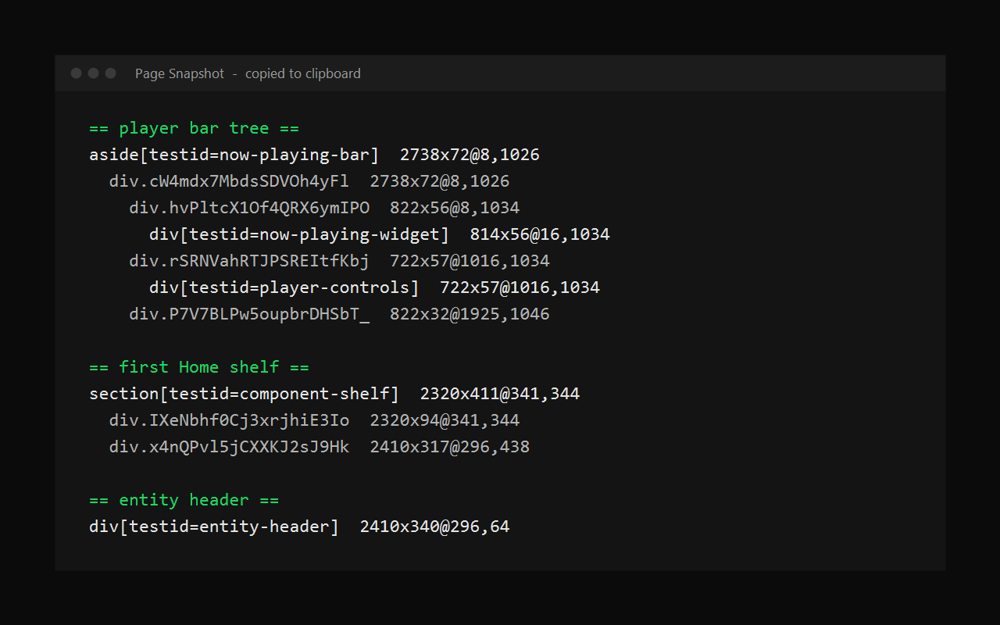

# Page Snapshot



Copy a text snapshot of Spotify's page structure to your clipboard in one click, and see the errors Spotify normally hides.

A [Spicetify](https://spicetify.app) extension for theme and extension authors.

## Why

Spotify renames its internal elements between versions, and themes and extensions that target the old names stop working without any error. Finding the new names normally means enabling DevTools and digging through the page by hand.

Page Snapshot gives you (or whoever is helping you) the relevant structure as plain text instead, so it can be pasted into an issue, a chat or a diff.

## What it captures

- Spotify version, Spicetify version, current theme, enabled extensions and custom apps
- The player bar, with its tag, classes, `data-testid`, size and position at each level
- The app grid, top bar and main view
- The first Home shelf and a Home shortcut tile
- The album, playlist or artist header, when one is on screen
- The right sidebar, when it is open
- The most recent errors from the error log (below)

The snapshot includes whatever is visible on the page you are on, such as track or playlist titles. It does not read account details, tokens or anything outside the page. Nothing is sent anywhere: the text goes to your clipboard and stops there.

## Error log

When something in Spotify silently fails (a menu that won't open, a page that shows "Something went wrong"), the real error only goes to the developer console. Page Snapshot keeps a running log of those errors from the moment Spotify starts and can show it on screen.

- Press **Ctrl+Alt+E** to show or hide the log in the bottom-left corner.
- Repeated errors are grouped (`x3`) instead of filling the list.
- **Copy** puts the log on your clipboard, **Clear** empties it.

It captures errors from Spotify, Spicetify and every extension, not only this one.

## Install

### Marketplace

Open the [Spicetify Marketplace](https://github.com/spicetify/marketplace), search for **Page Snapshot** and click install.

### Manual

1. Download [`pageSnapshot.js`](pageSnapshot.js) into your Spicetify `Extensions` folder.

   | Platform        | Path                              |
   | --------------- | --------------------------------- |
   | **Windows**     | `%appdata%\spicetify\Extensions\` |
   | **Linux/macOS** | `~/.config/spicetify/Extensions/` |

2. Run:

   ```
   spicetify config extensions pageSnapshot.js
   spicetify apply
   ```

## Usage

1. Open the page you want to inspect (Home, an album, a playlist).
2. Press **Ctrl+Alt+S**, or click your profile picture and choose **Copy page snapshot**.
3. Paste it wherever you need it.

Output looks like this:

```
Spotify 1.3.4.258 | Spicetify 2.45.3 | theme marketplace | window 2754x1106 | path /

== player bar tree ==
aside.n6XE6JL2UDeFogzbLcNC[testid=now-playing-bar] 2738x72@8,1026
  div.cW4mdx7MbdsSDVOh4yFl 2738x72@8,1026
    div.hvPltcX1Of4QRX6ymIPO 822x56@8,1034
      div.XQslIrb_llPUT81TqFnT[testid=now-playing-widget] 814x56@16,1034
```

Each line is `tag.classes[testid] WIDTHxHEIGHT@X,Y`.

## Uninstall

Remove it from the Marketplace **Installed** tab, or for a manual install run:

```
spicetify config extensions pageSnapshot.js-
spicetify apply
```

> [!NOTE]
> Tested on Spotify 1.3.4 and 1.3.5 with Spicetify 2.45.3. On Spotify 1.3.5, extension entries in the profile menu can stop the menu from opening; the keyboard shortcuts work either way. The snapshot is capped at 30,000 characters.

## Changelog

### v1.1.0

- Added an error log: press Ctrl+Alt+E to see errors from Spotify, Spicetify and extensions on screen.
- Snapshots now include the most recent errors.
- Added the Ctrl+Alt+S shortcut for copying a snapshot.

### v1.0.0

- Initial release.

## License

[MIT](LICENSE)
